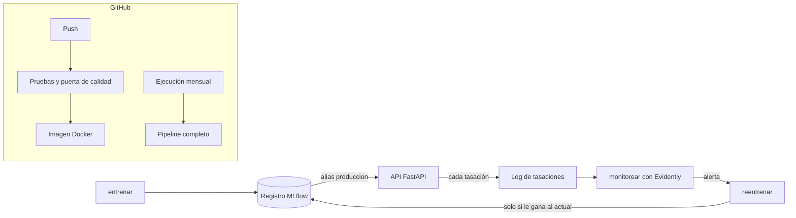

# Tasador de diamantes con MLOps

Ejemplo computacional de la exposición **MLOps / Deployment** del curso de Aprendizaje Automático (EAFIT, 2026-2).

Tomamos el modelo del **Reto 1 — Tasación automática de diamantes** y lo llevamos del notebook a un sistema que se puede operar: cada modelo queda versionado, se sirve con una API, se vigila mientras se usa y se reentrena solo cuando el mercado cambia.

## El caso

Un marketplace de diamantes recibe cientos de piedras al día y cada una necesita un precio de referencia antes de publicarse. En el Reto 1 construimos un modelo que tasa con un error típico de ~500 dólares (MAPE ≈ 6 %), pero vivía en un notebook: se ejecutaba a mano, producía un CSV y nadie se enteraría si dejaba de funcionar.

Este repositorio responde las preguntas que el notebook no podía responder:

| Pregunta | Respuesta en este proyecto | Herramienta |
|---|---|---|
| ¿Cuál de todos los modelos es el que está en uso? | Cada entrenamiento queda registrado y el modelo en uso tiene el alias `produccion` | MLflow |
| ¿Los datos se limpian igual al entrenar y al tasar? | La limpieza viaja empaquetada dentro del modelo | scikit-learn |
| ¿Cómo se tasa un diamante nuevo al instante? | Una API con formulario web | FastAPI |
| ¿Qué pasa si el mercado cambia? | Monitoreo de los datos y del error; si hay alerta, reentrenamiento automático | Evidently |
| ¿Cómo evitamos publicar un modelo peor? | Pruebas y puerta de calidad en cada cambio del código | GitHub Actions |

## Arquitectura



## Herramientas

| Herramienta | Para qué la usamos |
|---|---|
| **uv** | Instala las versiones exactas de `uv.lock`, para que el proyecto se comporte igual en cualquier computador |
| **scikit-learn + LightGBM** | La limpieza y el modelo del Reto 1 (LightGBM con hojas lineales sobre el precio por quilate) |
| **MLflow** | Guarda cada entrenamiento con sus parámetros, métricas, huella de los datos y modelo; el registro maneja las versiones y los alias `produccion` y `anterior` |
| **FastAPI + Uvicorn** | Sirven el modelo en producción como API y como formulario web |
| **Evidently** | Compara los diamantes que llegan con los de entrenamiento y genera un reporte HTML de drift |
| **pytest** | Pruebas de la limpieza, de la API y la puerta de calidad del modelo |
| **Docker** | Empaqueta la API con su modelo en una imagen que corre igual en cualquier servidor |
| **GitHub Actions** | Ejecuta las pruebas y construye la imagen en cada push, y corre el pipeline completo una vez al mes |

## Estructura del repositorio

```
mlops-diamantes/
├── datos/train.csv            datos del Reto 1
├── tasador/
│   ├── config.py              rutas, hiperparámetros y umbrales en un solo lugar
│   ├── datos.py               carga y partición de los datos
│   ├── preparacion.py         limpieza y variables del notebook, como transformador de scikit-learn
│   ├── modelo.py              los tres modelos candidatos y las métricas
│   ├── registro.py            todo lo que toca MLflow: guardar, registrar, promover y cargar
│   ├── tasaciones.py          log de tasaciones y ventas
│   ├── entrenar.py            paso 1
│   ├── api.py                 paso 2 (con formulario.html)
│   ├── simular_drift.py       paso 3
│   ├── monitorear.py          paso 4
│   ├── reentrenar.py          paso 5
│   └── pipeline.py            pasos 1, 3 y 4 en orden
├── tests/                     pruebas automáticas
├── Dockerfile
├── .github/workflows/
│   ├── ci.yml                 pruebas e imagen Docker en cada push
│   └── reentrenamiento.yml    pipeline completo el día 1 de cada mes
├── pyproject.toml
└── uv.lock
```

## Cómo ejecutarlo

Solo se necesita [Git](https://git-scm.com/) y [uv](https://docs.astral.sh/uv/getting-started/installation/). uv descarga la versión de Python que haga falta.

```bash
git clone https://github.com/Dalolito/mlops-diamantes.git
cd mlops-diamantes
uv sync
```

### Paso 1 — Entrenar y publicar el primer modelo

```bash
uv run entrenar
```

Entrena los tres candidatos del notebook (Baseline carat, LGB_ppc y LGB_lin_ppc), registra cada uno en MLflow y publica el mejor como versión 1 con el alias `produccion`. Para ver los experimentos:

```bash
uv run mlflow ui --backend-store-uri sqlite:///mlflow.db
```

y abrir <http://127.0.0.1:5000>.

### Paso 2 — Servir el modelo

```bash
uv run api
```

- <http://127.0.0.1:8000> — formulario para tasar un diamante.
- <http://127.0.0.1:8000/docs> — documentación interactiva de la API.

`POST /tasar` recibe las características del diamante y responde el precio, la versión del modelo que lo tasó y si necesita revisión humana (cuando la predicción cae fuera del rango de precios con que se entrenó). Cada tasación queda en `registros/tasaciones.csv`.

### Paso 3 — Simular el mercado de 2027

En otra terminal:

```bash
uv run simular-drift
```

Toma diamantes que el modelo nunca vio y simula un año de tasaciones y ventas con dos cambios: llegan más diamantes grandes (70 % de más de 1 quilate, frente a 35 % en la historia) y los precios reales suben un 15 %.

### Paso 4 — Monitorear (y reentrenar si hace falta)

```bash
uv run monitorear
```

Compara las tasaciones recientes con los datos de entrenamiento (`reportes/drift.html`) y el error con los precios reales de venta. Si la mitad o más de las columnas tienen drift, o si el error sube más de un 20 %, **lanza el reentrenamiento por sí solo**.

### Paso 5 — Reentrenar

Se ejecuta automáticamente desde el monitoreo, o a mano con `uv run reentrenar`. Usa la misma receta del modelo en producción, ajusta los precios históricos al nivel del mercado actual y entrena con la historia más las ventas nuevas. Después compara el modelo nuevo (retador) contra el que está en producción (campeón) con ventas que ninguno de los dos vio: **solo si el retador gana**, pasa a `produccion` y la versión vieja queda como `anterior`, por si hay que volver atrás.

Si la API está corriendo, toma la versión nueva sin apagarse con `POST /recargar` (desde <http://127.0.0.1:8000/docs>).

### Todo de una vez

```bash
uv run pipeline     # entrenar → simular 2027 → monitorear → reentrenar si hay alerta
uv run pytest       # pruebas
```

Para empezar de cero, borra `mlflow.db`, `mlruns/`, `registros/` y `reportes/`.

### Con Docker

La imagen ya trae el modelo entrenado:

```bash
docker build -t tasador-diamantes .
docker run -p 8000:8000 tasador-diamantes
```

GitHub Actions también la publica en `ghcr.io/dalolito/mlops-diamantes:latest`.

## Resultados esperados

Valores aproximados de una ejecución de `uv run pipeline`:

| Etapa | Resultado |
|---|---|
| Entrenamiento | Baseline carat: RMSE 1511 · LGB_ppc: 509 · **LGB_lin_ppc: 499**, que pasa a producción como versión 1 |
| Monitoreo | Drift en `carat`, `x`, `y`, `z` (las cuatro columnas de tamaño). El RMSE pasa de 499 a 1437 con las ventas de 2027: alerta |
| Reentrenamiento | Ajuste de mercado estimado: 1,153 (el real es 1,15). Campeón 1470 vs. retador 836 en ventas nuevas: el retador pasa a producción como versión 2 |

El monitoreo muestra algo importante: **la subida de precios no se ve en los datos de entrada**. Los diamantes que llegan se describen igual; lo que cambió es cuánto valen. Ese *concept drift* solo aparece cuando se conocen los precios reales de venta, por eso se vigilan tanto los datos como el error.

## Conceptos de MLOps en el código

- **Reproducibilidad.** `uv.lock` fija cada librería; MLflow guarda con cada modelo sus parámetros, sus métricas y la huella de los datos con que se entrenó.
- **Registro de modelos.** Las versiones se manejan como releases de software: `produccion` apunta a la que está en uso y `anterior` permite volver atrás.
- **Training-serving skew.** La limpieza (`PreparacionDiamantes`) está dentro del modelo, así que la API limpia cada diamante exactamente igual que en el entrenamiento.
- **Monitoreo.** Evidently elige una prueba por columna: Wasserstein para numéricas y Jensen-Shannon para categóricas con muestras grandes; Kolmogorov-Smirnov y chi-cuadrado con muestras pequeñas.
- **Entrenamiento continuo.** El monitoreo dispara el reentrenamiento, y la comparación campeón-retador evita publicar un modelo peor.
- **CI/CD.** Si un cambio en el código empeora el modelo (RMSE por encima de 560), la prueba falla y la imagen no se publica.
- **Infraestructura como código.** El pipeline, el horario mensual, la imagen y las reglas de calidad son archivos de texto versionados en este repositorio.

## Nivel de madurez y limitaciones

Según los niveles de madurez de MLOps de Google, el proyecto tiene entrenamiento continuo (nivel 1) y CI/CD del propio pipeline (nivel 2), pero todo corre en un computador o en GitHub, sin nube. En una empresa cambiaría lo siguiente:

- **MLflow** estaría en un servidor compartido (o integrado, como en Databricks). Aquí es local, así que cada ejecución mensual en GitHub arranca con un registro vacío y deja sus resultados para descargar.
- **La API** se alojaría en un servidor o en la nube; GitHub Actions construye la imagen, pero no la mantiene encendida.
- **Los datos de 2027 son simulados.** En la realidad saldrían de la base de datos del marketplace, donde se registra el precio real de cada venta.
- **La promoción a producción es automática.** Con dinero en juego, lo usual es exigir una aprobación humana antes de cambiar de versión.
- **Los datos no tienen fechas**, así que no se puede medir con backtesting cada cuánto conviene reentrenar.

## Origen

La limpieza (imputación de medidas en cero y corrección de medidas atípicas con reglas geométricas), las variables (`densidad_aparente`, codificación ordinal de `cut`, `color` y `clarity`) y el modelo LGB_lin_ppc con sus hiperparámetros vienen del notebook del Reto 1, donde se eligieron con validación cruzada. En el notebook este modelo se escogió como el "modelo de negocio" por ser uno solo, rápido de entrenar y fácil de explicar en dólares por quilate.

## Equipo

- David Lopera Londoño
